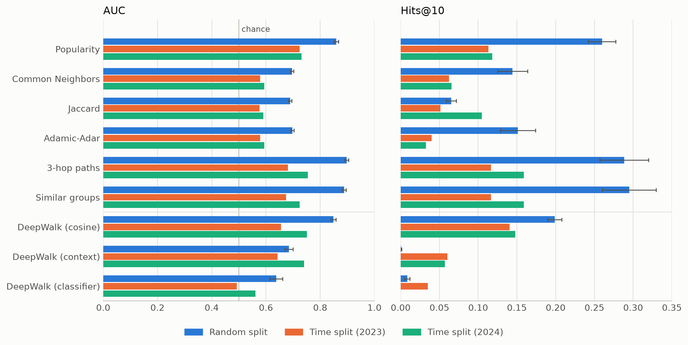

# Link Prediction on the MITRE ATT&CK Graph

CS579 Graph Learning final project, Illinois Institute of Technology. Author: Otioh Konan.

## What this project does

We model MITRE ATT&CK (Enterprise, version 20.1) as a graph of threat groups, techniques and software, and predict which techniques a group will be linked to. We compare:

- Popularity (how many groups use a technique)
- Classic link prediction heuristics: Common Neighbors, Jaccard, Adamic-Adar
- Two collaborative heuristics: 3-hop paths and Similar groups
- DeepWalk embeddings, scored three ways (cosine, context vectors, logistic regression)

Each method is tested on a random split (filling in missing edges) and on time splits (forecasting edges that MITRE added later).

## Data

The ATT&CK STIX bundle comes from https://github.com/mitre-attack/attack-stix-data and is downloaded by `src/download_data.py`. It is not stored in this repo.

After removing revoked and deprecated objects the graph has 178 groups, 706 techniques (sub-techniques included) and 842 software entries. Edges are "uses" relationships: 4,815 group-technique, 1,166 group-software and 11,608 software-technique.

## Setup

Tested with Python 3.13.

```
python3 -m venv .venv
source .venv/bin/activate
pip install -r requirements.txt
```

## How to run

Run everything from the repo root. Times are rough, on a laptop.

| Step | Command | Time | Output |
|---|---|---|---|
| 1 | `python src/download_data.py` | seconds | `data/raw/enterprise-attack.json` |
| 2 | `python src/build_graph.py` | seconds | `data/processed/nodes.csv`, `edges.csv` |
| 3 | `python src/splits.py` | seconds | split sizes and a leakage check |
| 4 | `python src/cutoff_diagnostics.py` | seconds | usable vs cold-start edges per cutoff year |
| 5 | `python src/run_baselines.py` | 2 min | `results/baselines.csv` |
| 6 | `python src/tune_embeddings.py` | 10 min | `results/tuning.csv` (validation data only) |
| 7 | `python src/run_embeddings.py` | 20 min | `results/embeddings.csv` |
| 8 | `python src/make_tables.py` | seconds | `results/summary.csv`, `results_table.tex`, `figures/results.png` and `.pdf` |
| 9 | `python src/failure_analysis.py` | 15 min | `results/failure_analysis.csv` |

Steps 6, 7 and 9 train DeepWalk and print many gensim warning lines (`Exception ignored in ... our_dot_float`). Training still works (embeddings score 0.915 AUC on their own training edges). To hide the warnings:

```
python src/run_embeddings.py 2>&1 | grep -v "Exception ignored"
```

## Evaluation protocol

- **Random split:** 20% of group-technique edges are hidden. Repeated with 5 seeds (mean and standard deviation reported).
- **Time split:** train on edges created up to a cutoff year (2023 and 2024), test on edges created after it. Software edges are also cut at the cutoff so no later information reaches training. A later edge is cold-start when its group or technique has no training edge. Cold-start edges are reported separately and are not part of the test set.
- **AUC:** hidden edges against an equal number of random group-technique pairs that are not edges anywhere in the data.
- **Hits@k:** for each test group, the share of its hidden techniques ranked in the top k of its candidate techniques, averaged over groups. Ties are broken randomly with a fixed seed.
- **Tuning:** DeepWalk settings were chosen on validation edges (15% of training edges, hidden from the training graph). Test edges were not used for tuning. The final settings are in `src/embeddings.py`.

## Results

AUC and Hits@10 for the main methods (full table in `results/results_table.tex`, all methods in `results/summary.csv`). Random split values are means over 5 seeds. Time split values are single runs.

| Method | Random AUC | Random H@10 | 2023 AUC | 2023 H@10 | 2024 AUC | 2024 H@10 |
|---|---|---|---|---|---|---|
| Popularity | 0.859 | 0.260 | 0.725 | 0.113 | 0.731 | 0.118 |
| 3-hop paths | 0.898 | 0.288 | 0.681 | 0.117 | 0.755 | 0.159 |
| DeepWalk (cosine) | 0.849 | 0.199 | 0.655 | 0.141 | 0.751 | 0.148 |



Main findings:

- Filling in missing edges is much easier than forecasting later ones.
- Popularity is a strong baseline. Common Neighbors, Jaccard and Adamic-Adar only see shared software, and score close to chance on the time splits.
- Popularity, 3-hop paths and Similar groups retrieve almost no rare or medium-popularity techniques (recall@50 near 0). DeepWalk (cosine) is the only method that retrieves some of them, and it is weaker on common techniques.
- About two thirds of the edges added after the cutoff belong to groups or techniques the training graph had never seen, mostly new groups. No method here can predict those.

## Limitations

- "Future" means the date MITRE added an edge to ATT&CK, which can differ from when a group started using a technique.
- The time splits have 534 (2023) and 302 (2024) test edges and one run each, so small differences between methods are within noise.
- The best DeepWalk window (40) is the largest value tried, so a larger window might do better. The tuning history is in `results/tuning_round1.csv`, `tuning_round2.csv` and `tuning_round3.csv`. `src/tune_embeddings.py` holds only the final grid.
- A GNN was left out for time.

## Repository layout

```
src/
  download_data.py       download the ATT&CK STIX file
  inspect_data.py        count objects by type and print the ATT&CK version
  build_graph.py         build nodes.csv and edges.csv
  splits.py              random, time and validation splits
  cutoff_diagnostics.py  usable vs cold-start edges per cutoff year
  heuristics.py          popularity and link prediction heuristics
  embeddings.py          DeepWalk, scoring functions, final settings
  evaluate.py            AUC and Hits@k
  reporting.py           save and print result tables
  run_baselines.py       run the heuristics on every split
  tune_embeddings.py     DeepWalk tuning on validation edges
  run_embeddings.py      run DeepWalk on every split
  make_tables.py         combined table, LaTeX table and figure
  failure_analysis.py    results by technique popularity, group size, cold-start
results/                 CSV results, LaTeX table, figures
```

All random choices use fixed seeds, so rerunning gives the same numbers.